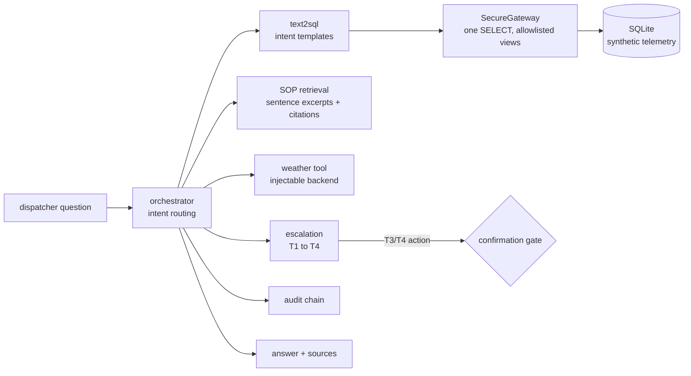

# Jagadish-coldchain-logistics-agents

[](https://github.com/jagadishmazure-jpg/Jagadish-coldchain-logistics-agents/actions/workflows/ci.yml)
[](https://github.com/jagadishmazure-jpg/Jagadish-coldchain-logistics-agents/actions/workflows/codeql.yml)


**A dispatcher assistant for a fictional refrigerated fleet: questions become template SQL over least-privilege views, answers cite the cold-chain SOPs, risk is mapped to escalation tiers, and reroutes wait for a human. Synthetic data, offline.**

> Personal learning and portfolio project. Everything runs offline on synthetic,
> fictional data with no API keys. Nothing is deployed. Numbers in this README
> come from real runs and are re-checked by CI (`scripts/render_docs.py --check`).

## Recruiter summary

- Orchestrator combines three tools (telemetry SQL, SOP retrieval, weather) and returns an answer with sources, a tier from T1 to T4, and a confirmation token for any high-impact action.
- Real run: 25 temperature-breach rows with the breach protocol quoted in whole sentences, a T4 escalation held for confirmation, and three unsafe SQL statements (a stacked DROP, a base table, the schema table) blocked with reason codes.
- Review fixes: SOP quotes were cut mid-sentence and retrieval missed the right SOP for two questions; now sentence-bounded excerpts and a heading boost, with tests.
- Security review (2026-10-18): three ways to read base tables past the view allowlist, a row cap any `LIMIT` could skip, and missed phone/SSN formats in feedback redaction; fixed with a SQLite authorizer, a fetch-time cap and new patterns. 96 tests.

## Purpose

I wanted an end-to-end agent for an operations domain where mistakes are
expensive (spoiled cargo) and the rules are written down (SOPs). The design
question is how much the agent may do on its own: it reads data only through
views, quotes procedures instead of paraphrasing them, and stops at a human
before rerouting a truck. This repo shares its design with the retail repo;
the overlap is documented in [docs/shared-spine.md](docs/shared-spine.md).

## Architecture



## How it works

**Data** (`coldchain/telemetry.py`, `coldchain/views.py`): a seeded SQLite
dataset of trucks, readings and shipments, exposed only through four views
(`v_fleet_status`, `v_temp_breaches`, `v_delay_risk`, `v_port_impact`). The
gateway allows one SELECT on allowlisted views and refuses anything else with
a reason code.

**SQL** (`coldchain/text2sql.py`): rule-based mapping from intent to a fixed
query template; no model writes SQL.

**SOPs** (`coldchain/sop_rag.py`): keyword retrieval over four SOP files with
a boost for matching headings, returning whole-sentence excerpts with a file
and section citation.

**Escalation** (`coldchain/escalation.py`): tiers from delay probability and
risk class, mirroring SOP 04; high-impact actions get a gate token.
Architecture: [knowledge/architecture.md](knowledge/architecture.md).

**Feedback** (`coldchain/feedback.py`): a thumbs up or down per turn, plus a
required correction on a thumbs-down, is appended to the same hash-chained
audit log, so `verify_chain` covers feedback too. Emails, phone numbers (including
`(555) 123-4567`), SSNs and numbers of 10 or more digits in the correction
are replaced before it is written.

## Real code and output

```python
"""Dispatcher questions against a synthetic reefer fleet (in-memory SQLite)."""
from pathlib import Path

from coldchain.audit import AuditLog
from coldchain.feedback import capture_feedback, list_feedback
from coldchain.orchestrator import Orchestrator
from coldchain.sop_rag import SopIndex, load_sops
from coldchain.telemetry import build_dataset
from coldchain.views import SecureGateway, SecurityDenial, create_views
from coldchain.weather import FakeWeather

ROOT = Path(__file__).resolve().parent.parent
conn = build_dataset(":memory:", seed=20260801)
create_views(conn)
gateway = SecureGateway(conn)
orch = Orchestrator(gateway, SopIndex(load_sops(ROOT / "docs" / "sops")), FakeWeather())

for q in ["Show temperature breaches and what does the SOP say about the breach protocol?",
          "Which shipments have high delay risk and what are the escalation tiers?"]:
    a = orch.run(q)
    print(f"> {q}\n{a.text}\nSources: {a.sources}\n")

print("SQL guard (agent-issued SQL that must be refused):")
for sql in ["SELECT * FROM v_temp_breaches; DROP TABLE telemetry",
            "SELECT * FROM telemetry",
            "SELECT name FROM sqlite_master"]:
    try:
        gateway.execute(sql)
        print("  ALLOWED", sql)
    except SecurityDenial as e:
        print("  BLOCKED", sql, "->", e)
print("\naudit chain intact:", orch.audit.verify_chain())

# Feedback capture: thumbs up/down into the same hash-chained audit log, emails, phones, SSNs and long numbers redacted.
fb_log = AuditLog()
capture_feedback(fb_log, session_id="s-demo", turn_id="t1", rating="up")
fb = capture_feedback(fb_log, session_id="s-demo", turn_id="t2", rating="down",
                      correction="wrong ETA, call me on +1 555 010 2030")
print(f"Feedback: {len(list_feedback(fb_log))} entries, stored correction {fb['payload']['correction']!r}, "
      f"redactions {fb['payload']['pii_redactions']}, chain verifies: {fb_log.verify_chain()}")
```

Output of `python examples/demo.py` (real run, re-checked in CI):

<!-- run: python examples/demo.py -->
```text
> Show temperature breaches and what does the SOP say about the breach protocol?
Telemetry — Reefer temperature breaches (outside 0-4 C).: 25 row(s) returned.

Compliance — Based on the cold-chain SOPs:
- A breach is any confirmed reefer temperature reading outside the 0-4 C band for fresh perishables (see the temperature control standard). [sop-02-breach-protocol.md § Breach Definition]
- The customer is informed of any confirmed breach within 4 hours, with the readings, the QA disposition, and the corrective action. Never ship quarantined product while assessment is pending. [sop-02-breach-protocol.md § Customer Communication]
- Quarantine the trailer: no further loading or unloading. Notify QA and the dispatcher with the truck ID, timestamp, and peak temperature. Instruct the driver to keep the reefer running and doors closed. Log the incident in the audit system with the sensor readings attached. [sop-02-breach-protocol.md § Immediate Actions (0-30 Minutes)]

Escalation — tier T4 (Critical) for truck TRK-001. High-impact actions require human confirmation (gate token reroute_shipment-0001); nothing was rerouted automatically.
Sources: ['view v_temp_breaches', 'sop-02-breach-protocol.md § Breach Definition', 'sop-02-breach-protocol.md § Customer Communication', 'sop-02-breach-protocol.md § Immediate Actions (0-30 Minutes)']

> Which shipments have high delay risk and what are the escalation tiers?
Telemetry — Shipments ranked by delay probability.: 25 row(s) returned.

Compliance — Based on the cold-chain SOPs:
- T1 Normal: delay probability below 0.4 and risk class low. Routine monitoring. T2 Watch: delay probability 0.4 to below 0.7, or risk class medium. Increase tracking cadence and monitor the next readings. T3 High: delay probability at or above 0.7, or risk class high. [sop-04-escalation-tiers.md § Tier Definitions]
- T3 and T4 high-impact actions — rerouting a shipment, diverting a port call, or cancelling a shipment — require explicit human confirmation through the confirmation gate before execution. The gate token, the approver, and the decision timestamp are recorded in the audit log. [sop-04-escalation-tiers.md § Confirmation Gates]
- Each tier's actions are mandatory, not advisory. Skipping a T3 customer notification or a T4 quarantine is a compliance violation and is flagged in the audit review. [sop-04-escalation-tiers.md § Required Actions per Tier]

Escalation — tier T4 (Critical) for truck TRK-009. High-impact actions require human confirmation (gate token reroute_shipment-0002); nothing was rerouted automatically.
Sources: ['view v_delay_risk', 'sop-04-escalation-tiers.md § Tier Definitions', 'sop-04-escalation-tiers.md § Confirmation Gates', 'sop-04-escalation-tiers.md § Required Actions per Tier']

SQL guard (agent-issued SQL that must be refused):
  BLOCKED SELECT * FROM v_temp_breaches; DROP TABLE telemetry -> [SEC-SELECT-01] Multiple statements are not permitted; one SELECT only.
  BLOCKED SELECT * FROM telemetry -> [SEC-VIEW-03] Access to 'telemetry' denied: only allowlisted read-only views may be queried (v_delay_risk, v_fleet_status, v_port_impact, v_temp_breaches).
  BLOCKED SELECT name FROM sqlite_master -> [SEC-VIEW-03] Access to 'sqlite_master' denied: only allowlisted read-only views may be queried (v_delay_risk, v_fleet_status, v_port_impact, v_temp_breaches).

audit chain intact: True
Feedback: 2 entries, stored correction 'wrong ETA, call me on [NUMBER]', redactions 1, chain verifies: True
```
<!-- /run -->

## How to run

```bash
git clone https://github.com/jagadishmazure-jpg/Jagadish-coldchain-logistics-agents.git
cd Jagadish-coldchain-logistics-agents
python -m pip install pytest      # no runtime dependencies
python -m pytest -q          # offline, no keys
python examples/demo.py
python scripts/render_docs.py --check   # documented output still matches
```

Test suite size (real collection, re-checked in CI):

<!-- run: python scripts/count_tests.py -->
```text
96 tests collected
```
<!-- /run -->

## Guardrails

- Read-only access through allowlisted views; one statement; base and system tables refused by the gateway's rules and, behind them, by a SQLite authorizer that only allows reads of the four views. At most 100 rows are fetched.
- SQL comes from templates, not from a model.
- SOP text is quoted with a citation, not paraphrased.
- Reroutes and other T3/T4 actions return a confirmation token; nothing is executed automatically.
- Every step is written to a hash-chained audit log.
- Feedback corrections are capped at 2,000 characters, and emails, phone numbers (including `(555) 123-4567`), SSNs and long numbers are redacted before they reach the append-only audit log.

## Limitations

- Intent routing and SQL are rules; questions outside the templates are not answered.
- SOP retrieval is keyword based; it works on these four documents, not a large library.
- Synthetic telemetry is dated 2021 to 2024, so the views are not 'live'.
- Weather is a fake backend in the demo and tests.
- Feedback redaction is four regexes (emails, phone numbers, SSN shape, 10+ digit numbers), not a full PII detector; names and street addresses are not caught.

## Security review (2026-10-18)

The batch-1/2 domain repos copied this spine; reviewing them found gateway and redaction bugs that turned out to start here. Reproduced in this repo, fixed, and pinned by tests (`tests/test_gateway_backstop.py`, review tests in `tests/test_feedback.py`):

1. **Gateway allowlist bypass.** The gateway only checked names written right after `FROM`/`JOIN` plus whitespace. `SELECT * FROM v_fleet_status, trucks` (comma join), `SELECT name, sql FROM "sqlite_master"` (quoted name) and `SELECT * FROM/**/trucks` (comment as whitespace) all read base tables or the schema. A SQLite authorizer (`coldchain/authz.py`, ADR 0001) now lets the engine refuse any read that is not one of the four views; denials still cite `SEC-VIEW-03`.
2. **Row cap skipped by any caller-written LIMIT.** `MAX_LIMIT` was only appended when the text had no `LIMIT`, so `... LIMIT 100000` on a view self-join returned 15,376 rows. Rows past 100 are now never fetched (`fetchmany`), whatever LIMIT the query carries.
3. **Feedback redaction missed common phone and SSN formats.** `(555) 123-4567` and `+1 (555) 123-4567` broke the digit-run pattern on the `) ` and `123-45-6789` is only 9 digits, so all three were stored in the audit log. Phone and SSN patterns were added; dates and short IDs are still left alone (tested).

### Authorizer template sync (2026-10-18)

The SQLite authorizer was updated to the shared strict, view-aware version.
A base-table read is allowed only when SQLite reports it on behalf of one of
the allowed views (the authorizer's view-name argument). A read with no view
name is denied. `sqlite_master` is always denied, even if listed, and so is
`load_extension`. None of this repo's views hit the false denial, so the change is preventive here.
`tests/test_authorizer_sync.py` drives the authorizer directly, independent
of the text check. It covers comma joins and comment-obfuscated joins with a
base table, every view, and view self-joins.

Known residual: a read that uses no columns of a table behind a view is
allowed, because SQLite reports the unused side of a view self-join the same
way. So `SELECT count(*) FROM <that table>` or `EXISTS (SELECT 1 FROM ...)`
can still reveal a row count, but no column data. Any column reference is
denied.

## Built vs planned

| Capability | Status | Where |
|---|---|---|
| Synthetic telemetry and governed views | Built | `coldchain/telemetry.py`, `coldchain/views.py` |
| Template text-to-SQL | Built | `coldchain/text2sql.py` |
| SOP retrieval with citations | Built | `coldchain/sop_rag.py` |
| Escalation tiers and confirmation gate | Built | `coldchain/escalation.py` |
| Orchestrator and audit | Built | `coldchain/orchestrator.py`, `coldchain/audit.py` |
| User feedback in the audit chain, with redaction | Built | `coldchain/feedback.py` |
| Model-based intent and answer writing | Planned | docs/implementation-guide.md |
| Live telematics feed | Planned | not started |

## Threat model

| Threat | Mitigation in this repo | Status |
|---|---|---|
| Agent runs destructive or broad SQL | Template SQL, one SELECT, allowlisted views enforced by a SQLite authorizer, 100-row fetch cap | Built |
| Personal data in feedback text | Email, phone, SSN and long-number redaction before the audit log | Built |
| Agent reroutes a shipment on its own | Confirmation gate for T3/T4 actions | Built |
| Misquoted procedure | Whole-sentence excerpts with citations | Built |
| Tampered decision record | Hash-chained audit | Built |
| Prompt injection via SOP text | No model in the loop yet; needed once one is added | Planned |

## Interview points

- The agent cannot write SQL; it picks a template, and the gateway would refuse anything else anyway.
- Quotes must be whole sentences with a citation; a cut-off quote in my first version could change the meaning.
- Escalation follows the SOP's own tiers, so the rules are owned by operations, not the model.

More, with likely follow-up questions: [docs/interview-points.md](docs/interview-points.md).

## Implementation guide

The step-by-step path from this offline build to an Azure deployment is in
[docs/implementation-guide.md](docs/implementation-guide.md). None of it has been
run; it is a plan.

## Related repositories

| Repo | How it relates |
|---|---|
| [Jagadish-retail-ops-agents](https://github.com/jagadishmazure-jpg/Jagadish-retail-ops-agents) | Same spine, retail domain (see docs/shared-spine.md) |
| [Jagadish-text2sql-data-agent](https://github.com/jagadishmazure-jpg/Jagadish-text2sql-data-agent) | Text-to-SQL in more depth |
| [Jagadish-governed-data-agent](https://github.com/jagadishmazure-jpg/Jagadish-governed-data-agent) | Governed data access for agents |
| [Jagadish-event-driven-agents](https://github.com/jagadishmazure-jpg/Jagadish-event-driven-agents) | Reacting to telemetry events |
| [Jagadish-agent-feedback-loop](https://github.com/jagadishmazure-jpg/Jagadish-agent-feedback-loop) | Turns captured feedback into eval cases and a regression gate |

## Documentation

- [Architecture](knowledge/architecture.md)
- [FDE approach](knowledge/fde-approach.md)
- [Shared spine with retail](docs/shared-spine.md)
- [SOPs](docs/sops/)
- [Implementation guide (Azure)](docs/implementation-guide.md)
- [Interview points](docs/interview-points.md)
- [ADR 0001: SQLite authorizer backstop](docs/adr/0001-sqlite-authorizer-backstop.md)
- [Security policy](SECURITY.md)

## Project layout

```
coldchain/
  telemetry.py    seeded SQLite dataset
  views.py        governed views + SecureGateway
  text2sql.py     intent templates
  sop_rag.py      SOP retrieval, sentence excerpts
  weather.py      weather tool (fake + live)
  escalation.py   tiers, confirmation gate
  orchestrator.py routing, tools, answer
  audit.py        hash-chained log
  feedback.py     thumbs up/down + correction into the log
docs/sops/        four SOPs
examples/demo.py  the run shown above
tests/            offline pytest suite
```

## License

MIT, see [LICENSE](LICENSE). All data is synthetic; every organisation and person is fictional.
