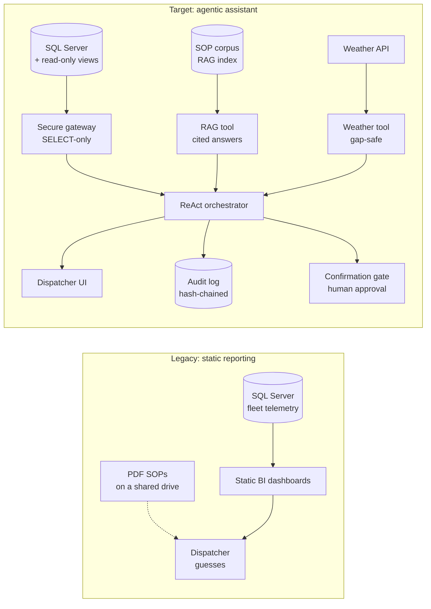
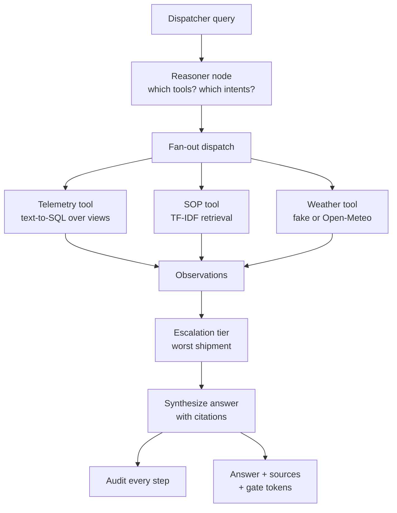
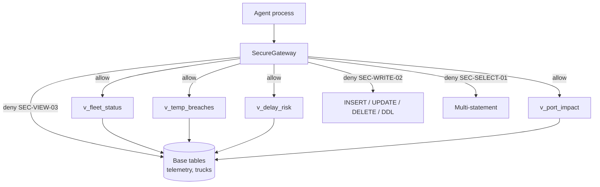
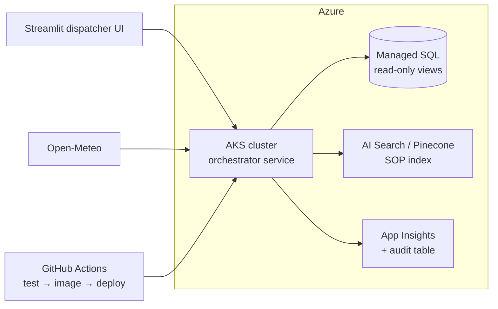

# Architecture

## Legacy vs target

## ReAct loop

## Security model

The database role behind the gateway would additionally hold only
`SELECT` on the views in production — defense in depth, not prompt
wishes.

## Deploy topology (production path)

